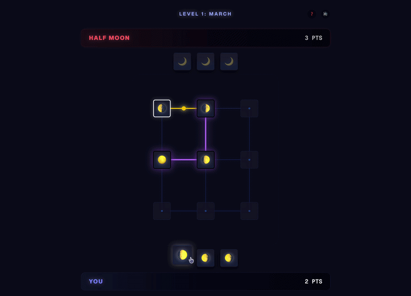

# 🌜 Rise of Halfmoon

> Strategic moon phase card game - Battle the Half Moon

[](https://rise-of-halfmoon.vercel.app/)

A card game where you connect moon phases to score points. Match same phases, create lunar cycles, and outsmart your opponent!

This project is a clone coding of the Google Doodle Moon game.  
I am a big fan of the Google Doodle Moon game, so I decided to recreate it myself.

Original game:  
https://doodles.google/doodle/rise-of-the-half-moon/

## 🎮 Gameplay Preview



## ✨ Features

- **Campaign**: 5 boards, from March to December, against an AI that gets tougher as you go
- **Star ratings**: win by a bigger margin to earn up to ★★★ on each level, then replay any unlocked level to improve your rating
- **Daily Challenge**: one new board each day, with the same deck for everyone. Your first finished game counts, and you can share the result
- **Records**: win rate, high score, longest cycle, cycles stolen, daily streak and per-level bests
- Works on desktop and mobile; your progress is saved in your browser, so no account is needed

## 🎴 Game Rules

Take turns placing moon phase cards from your hand onto the star map. Tap a card, then tap an empty spot (or drag it there on desktop).

### Scoring Methods

**1. Phase Pair (1 point)**
- Match two identical moon phases
- Example: 🌒 + 🌒

**2. Full Moon Pair (2 points)**
- Match opposite phases that form a full moon
- Example: 🌒 + 🌖

**3. Lunar Cycle (N points)**
- Connect 3+ cards in phase order
- Score = number of cards in chain
- Example: 🌑 → 🌒 → 🌓 = 3 points

### Special Rules
- **Chain Steal**: Opponent can steal your chain by adding to it
- **Card Bonus**: +1 point per card you control at game end

### Star Ratings

Stars depend on how much you win by, scaled to the board size:

| Rating | Winning margin |
| --- | --- |
| ★ | any win |
| ★★ | a third of the board's spots or more |
| ★★★ | two thirds of the board's spots or more |

For example, on March's 9-spot board you need to win by 3 for ★★ and by 6 for ★★★.

## 🛠 Tech Stack

- Next.js 16 (App Router)
- React 19 + TypeScript
- Tailwind CSS 4
- Framer Motion

## 🚀 Running Locally

```bash
npm install
npm run dev
```

Then open http://localhost:3000.

## 📁 Project Structure

```
app/            Page, game state and turn logic
components/     Screens (start, intro, tutorial, records) and moon cards
components/game Board, player panels, pause menu and result screen
components/ui   Shared buttons, modal, icons and background
constants/      Level layouts and theme colors
utils/          Scoring, AI, sounds, records and daily challenge
```

---

*Connect the cosmos, one phase at a time* 🌙
